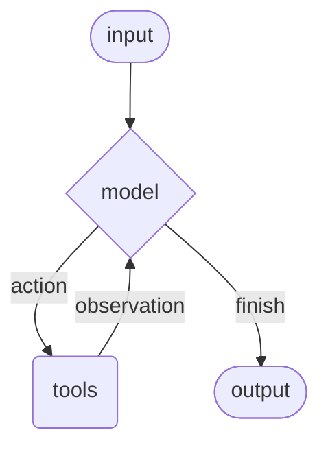

# Agents

Agents combine chat models with tools to build systems that can reason about a
task, choose actions, observe tool results, and continue until a final response
or stop condition is reached.

BeamWeaver agents are graph-backed. The public API is Elixir-native:
`use BeamWeaver.Agent` for application modules and `BeamWeaver.Agent.build/1`
for runtime-configured agents. Both compile to the same `BeamWeaver.Graph`
runtime with a model node, optional tool node, middleware nodes, checkpoints,
interrupts, typed streams, and tagged errors.



## Semantic Module Shape

Stable application agents should use category blocks. This keeps model-callable
tools, lifecycle middleware, subagents, prompts, and structured output visible
at a glance:

```elixir
defmodule MyApp.SupportAgent do
  use BeamWeaver.Agent

  name "support_agent"
  description "Answer support questions from approved sources."

  model "openai:gpt-5.4", temperature: 0.2, timeout: 120_000

  tools do
    tool MyApp.Tools.SearchDocs
  end

  middleware do
    use BeamWeaver.Agent.Middleware.ToolCallNormalization
    use BeamWeaver.Agent.Middleware.ModelRetry, max_attempts: 6, retry_on: :transient
  end

  system_prompt "Answer only from retrieved documentation."
  response_schema MyApp.Schemas.SupportAnswer, name: "support_answer"
end
```

Use `BeamWeaver.Agent.build/1` when the same fields need to be assembled at
runtime. See [Semantic DSL](semantic_dsl.md) for the full module surface.

## Core Components

### Model

The model is the reasoning engine for the agent. BeamWeaver accepts any value
that implements `BeamWeaver.Core.ChatModel`.

#### Static Model

Static models are configured once and used for every model call.

Use a provider-prefixed model identifier when you want BeamWeaver to construct
the model:

```elixir
model =
  BeamWeaver.Models.init_chat_model!("openai:gpt-5.4",
    temperature: 0.1,
    max_output_tokens: 1_000,
    timeout: 30_000
  )

{:ok, agent} =
  BeamWeaver.Agent.build(
    name: "support_agent",
    model: model,
    tools: []
  )
```

The model's `:timeout` is used twice in agent builds:

- Provider transport timeout: the HTTP receive budget passed to the model
  adapter.
- Agent model-node timeout: the graph node budget for the model call.

Agent model nodes are graph nodes, so they still have a hard execution budget.
BeamWeaver chooses the generated model node timeout in this order:

1. `model_opts[:timeout]` from `BeamWeaver.Agent.build/1` or the `model/2` DSL.
2. `model.timeout` when the configured model struct exposes a timeout field.
3. The graph node default of `5_000` milliseconds.

For long summarization, extraction, or tool-heavy calls, set the timeout on the
model or through `model_opts`:

```elixir
{:ok, agent} =
  BeamWeaver.Agent.build(
    model: "openai:gpt-5.4",
    model_opts: [
      timeout: 120_000,
      max_output_tokens: 2_000
    ],
    tools: []
  )
```

```elixir
defmodule MyApp.SummaryAgent do
  use BeamWeaver.Agent

  model "anthropic:claude-sonnet-4-6", timeout: 120_000
end
```

`BeamWeaver.Agent.invoke(..., timeout: value)` is not the model-node timeout; it
is an invocation/server call option. When invoking through a supervised agent
server process, keep that call timeout at least as large as the model-node
timeout.

OpenAI identifiers can also be inferred:

```elixir
model = BeamWeaver.Models.init_chat_model!("gpt-5.4")
```

Google Gemini identifiers must be explicit:

```elixir
model = BeamWeaver.Models.init_chat_model!("google:gemini-3.5-flash")
```

For tests, examples, or local workflows, use the fake provider:

```elixir
model =
  BeamWeaver.Models.init_chat_model!("fake:chat",
    response: BeamWeaver.Core.Message.assistant("hello")
  )
```

You can also configure an agent as a normal module:

```elixir
defmodule MyApp.SupportAgent do
  use BeamWeaver.Agent

  model BeamWeaver.Models.init_chat_model!("openai:gpt-5.4")
end
```

#### Dynamic Model

Dynamic models are selected at the model-call boundary with middleware. Keep a
static default model on the agent, then override `%BeamWeaver.Agent.ModelRequest{}`
when runtime state or context calls for a different model:

```elixir
defmodule MyApp.DynamicModelSelection do
  @behaviour BeamWeaver.Agent.Middleware

  alias BeamWeaver.Agent.ModelRequest

  def wrap_model_call(%ModelRequest{} = request, handler) do
    model =
      if length(request.messages || []) > 10 do
        BeamWeaver.Models.init_chat_model!("openai:gpt-5.4")
      else
        BeamWeaver.Models.init_chat_model!("openai:gpt-5.4-mini")
      end

    request
    |> ModelRequest.override(model: model)
    |> handler.()
  end
end

defmodule MyApp.AgentWithDynamicModel do
  use BeamWeaver.Agent

  model BeamWeaver.Models.init_chat_model!("openai:gpt-5.4-mini")

  middleware do
    use MyApp.DynamicModelSelection
  end
end
```

When structured output is enabled, prefer unbound model instances. Let the agent
attach tools and response-format options at the model boundary.


**Dynamic Behavior Lives In Middleware**


<!-- Content truncated to meet Windsurf 6KB limit -->

---
> Source: [caudena/beam_weaver](https://github.com/caudena/beam_weaver) — distributed by [TomeVault](https://tomevault.io).
<!-- tomevault:4.0:windsurf_rules:2026-10-06 -->
