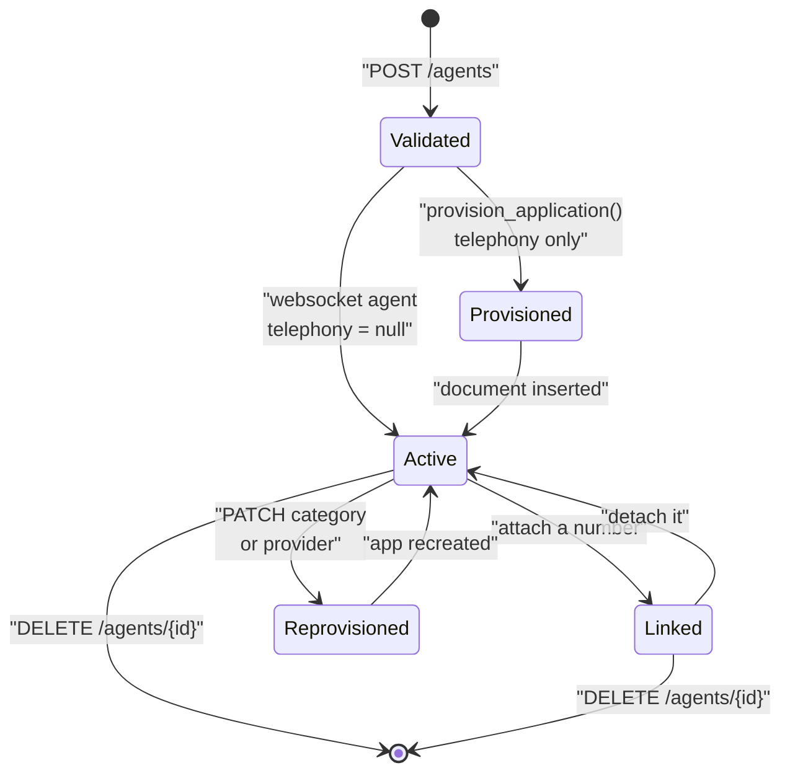

An agent is the configuration a call runs on. This page covers what lives on an agent document, the difference between the two agent categories, and the side effects the API performs on your telephony provider when you create, change, or delete one.

<Note>
Agents hold **no secrets**. Model API keys live in [`ProviderAuth`](../../developer/reference/provider-auth) and are merged in at call time. Sending a secret field inside `config.models` is rejected by validation.
</Note>

## What an agent is

An agent is a document in the `Agents` collection, scoped to one organisation. It stores:

* a name, unique within the organisation
* an `agent_category` that decides how calls reach it
* prompts, behaviour settings, language, and non-secret model configuration
* an optional knowledge-base attachment
* for telephony agents, a provisioned provider application and an optional linked phone number

Agents are created by any organisation member (`created_by` is taken from the JWT email) and deleted only by `admin` or `super_admin`. See [Multi-tenancy and roles](../../developer/reference/multi-tenancy).

## telephony vs websocket

`agent_category` is `Literal["telephony", "websocket"]`, defined in `apps/api/app/models/schemas.py`. It is the single field that decides everything about how the agent is reached.

| | `telephony` | `websocket` |
| --- | --- | --- |
| `telephony_provider` on create | Required | Must not be set |
| Provider application | Provisioned by the API on create | None |
| `telephony` on the document | An `AgentTelephonyAttachment` | `null` |
| `GET /answer` on the runtime | Returns provider Stream XML | Returns `400` |
| WebSocket connection | Provider media stream; expects a `start` event | Direct browser connection |
| Frame serializer | `create_frame_serializer(provider, …)` | `ProtobufFrameSerializer` (RTVI) |
| Sample rate | `SAMPLE_RATE`, default `8000` | `WEBSOCKET_SAMPLE_RATE`, default `16000` |
| Creates a `CallLog` | Yes | No |

The runtime resolves the category with `agent_category()` in `apps/runtime/services/agent_routing.py`, which **defaults to `websocket`** when the field is missing and raises `AgentRoutingError` for any other value.

<Tabs>
<Tab title="telephony">
Set `agent_category: "telephony"` and a `telephony_provider` that is registered in `apps/telephony` — check `GET /configuration/telephony` for the current list. Organisation credentials for that provider must already exist via `POST /auth`, and `VOICE_SERVER_BASE_URL` must be configured, or creation fails.

```json
{
  "name": "Support Agent",
  "agent_category": "telephony",
  "telephony_provider": "vobiz",
  "config": { "...": "..." }
}
```
</Tab>

<Tab title="websocket">
Set `agent_category: "websocket"` and omit `telephony_provider` entirely. Sending it raises a validation error. No provider account, no credentials, and no `VOICE_SERVER_BASE_URL` are needed.

```json
{
  "name": "Browser Demo",
  "agent_category": "websocket",
  "config": { "...": "..." }
}
```
</Tab>
</Tabs>

## The agent document

`AgentResponse` is the full shape returned by every agent route:

| Field | Type | Notes |
| --- | --- | --- |
| `agent_id` | `str` | Server-generated UUID4. Also used as the provider application name. |
| `org_id` | `str` | Owning organisation. |
| `name` | `str` | Unique per organisation; a clash returns a conflict. |
| `status` | `Literal["active", "archived"]` | Set to `"active"` on create. |
| `agent_category` | `Literal["telephony", "websocket"]` | See above. |
| `created_by` | `str` | Email from the creating JWT. |
| `linked_phone_number` | `str \| null` | Set by phone-number attach, cleared by detach. |
| `telephony` | `AgentTelephonyAttachment \| null` | `null` for websocket agents. |
| `config` | `AgentConfigPayload` | Prompts, behaviour, language, models, knowledge base, custom variables. |
| `created_at`, `updated_at` | `str \| null` | ISO 8601 UTC. |

`AgentTelephonyAttachment` carries `provider`, `application_id`, `answer_url`, and an optional `hangup_url` — optional only because agents provisioned before hangup URLs were always set may lack it.

`AgentConfigPayload` holds `schema_version` (default `1`), `prompts`, `behaviour`, `language`, `models`, `knowledge_base`, and `custom_variables`. Every field is documented in [Agent configuration](../../developer/reference/agent-configuration); how the runtime consumes it is in [Voice pipeline](voice-pipeline).

## Lifecycle and side effects

Creating or changing an agent can call out to your telephony provider. This diagram is the full state machine implemented by `agent_service.py` and `agent_telephony_service.py`:




<!-- Content truncated to meet Windsurf 6KB limit -->

---
> Source: [COSS-India/VoicEra](https://github.com/COSS-India/VoicEra) — distributed by [TomeVault](https://tomevault.io).
<!-- tomevault:4.0:windsurf_rules:2026-10-06 -->
