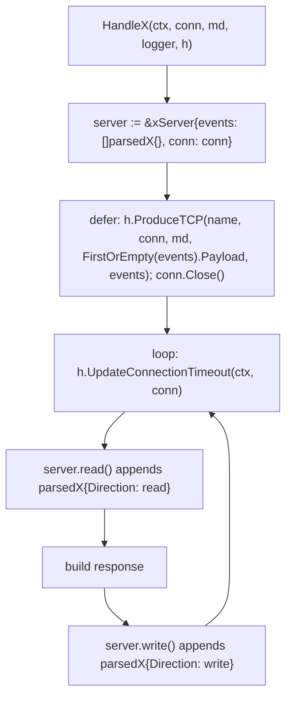

# AGENTS.md

Guidance for agents working on Glutton, with a focus on protocol handlers. Read
[CONTRIBUTING.md](CONTRIBUTING.md) for the general contribution rules and
[docs/protocols/adding-a-protocol.md](docs/protocols/adding-a-protocol.md) for the
end-to-end checklist (registration, rules, Spicy). This file describes the
canonical shape of a handler so new or refactored handlers stay consistent.

## Where things live

| Path | Purpose |
| --- | --- |
| `protocols/tcp/*.go` | One file per TCP protocol handler (`HandleSMTP`, `HandleSMB`, ...). |
| `protocols/tcp/<proto>/` | Optional sub-package with pure parsing / response-building code (e.g. `protocols/tcp/smb/`, `protocols/tcp/rdp/`). |
| `protocols/udp/*.go` | UDP handlers (`HandleUDP` catch-all, `HandleSIP`, `HandleOpenVPN`, `HandleMDNS`, `HandleL2TP`, `HandleKerberos`, `HandleCoAP`, …). |
| `protocols/protocols.go` | Handler registry: maps rule `target` names to handler funcs. |
| `protocols/interfaces/` | `Logger` and `Honeypot` interfaces every handler receives. |
| `protocols/helpers/` | `FirstOrEmpty`, `Store` (content-addressed file storage). |
| `protocols/mocks/` | mockery-generated `MockHoneypot` / `MockLogger`. |
| `producer/` | `producer.Event` envelope and sinks (log, HPFeeds, HTTP). |
| `config/rules.yaml` | Which traffic reaches which handler. |

## Canonical TCP handler

Every TCP handler follows the same lifecycle: collect everything that happens on
the connection into an in-memory slice of per-direction frames, then emit a
**single** producer event when the connection ends.



Skeleton (see `protocols/tcp/smb.go`, `ftp.go`, `smtp.go` for complete examples):

```go
package tcp

// parsedX is one frame of the session. Field names and json tags are the
// contract with downstream consumers; keep them stable.
type parsedX struct {
	Direction string   `json:"direction,omitempty"` // "read" (from attacker) or "write" (from honeypot)
	Header    x.Header `json:"header,omitempty"`    // optional: parsed protocol header
	Command   string   `json:"command,omitempty"`   // leaf operation (verb, opcode, Trans2 setup name, HTTP method)
	Path      string   `json:"path,omitempty"`      // optional: share, filename, URL path
	Status    string   `json:"status,omitempty"`    // optional: named write outcome (NT status, HTTP 200)
	Payload   []byte   `json:"payload,omitempty"`   // raw bytes as seen on the wire
	Truncated bool     `json:"truncated,omitempty"` // set when a capture cap dropped trailing bytes
}

type xServer struct {
	events []parsedX
	conn   net.Conn
	// protocol state (session IDs, buffered reader, ...) goes here
}

func (s *xServer) read() ([]byte, error) {
	// read one frame/line from s.conn, then:
	s.events = append(s.events, parsedX{Direction: "read", Payload: data})
	return data, nil
}

func (s *xServer) write(data []byte) error {
	if _, err := s.conn.Write(data); err != nil {
		return err
	}
	s.events = append(s.events, parsedX{Direction: "write", Payload: data})
	return nil
}

// HandleX takes a net.Conn and does basic X communication
func HandleX(ctx context.Context, conn net.Conn, md connection.Metadata, logger interfaces.Logger, h interfaces.Honeypot) error {
	server := &xServer{events: []parsedX{}, conn: conn}
	defer func() {
		if err := h.ProduceTCP("x", conn, md, helpers.FirstOrEmpty[parsedX](server.events).Payload, server.events); err != nil {
			logger.Error("Failed to produce message", slog.String("protocol", "x"), producer.ErrAttr(err))
		}
		if err := conn.Close(); err != nil {
			logger.Debug("Failed to close X connection", slog.String("protocol", "x"), producer.ErrAttr(err))
		}
	}()

	for {
		if err := h.UpdateConnectionTimeout(ctx, conn); err != nil {
			logger.Debug("Failed to set connection timeout", slog.String("protocol", "x"), producer.ErrAttr(err))
			return nil
		}
		data, err := server.read()
		if err != nil {
			logger.Debug("Failed to read data", slog.String("protocol", "x"), producer.ErrAttr(err))
			break
		}
		resp, err := buildResponse(data)
		if err != nil {
			return err
		}
		if err := server.write(resp); err != nil {
			return err
		}
	}
	return nil
}
```

### Rules

- **Signature**: `HandleX(ctx context.Context, conn net.Conn, md connection.Metadata, logger interfaces.Logger, h interfaces.Honeypot) error`. Register it in `protocols/protocols.go` under the handler key used in `config/rules.yaml`; the key is also the string passed to `ProduceTCP`.
- **One event per session**: never call `h.ProduceTCP` inside the read loop. Append to `server.events` and emit once from the deferred block. The top-level payload is `helpers.FirstOrEmpty(server.events).Payload`; the full slice is the `decoded` field.

<!-- Content truncated to meet Windsurf 6KB limit -->

---
> Source: [mushorg/glutton](https://github.com/mushorg/glutton) — distributed by [TomeVault](https://tomevault.io).
<!-- tomevault:4.0:windsurf_rules:2026-10-06 -->
